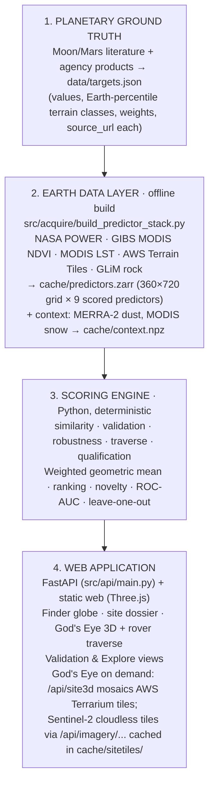

# Astronautical Atlas

*A research and exploration tool for comparing lunar and Martian regions with Earth environments.*

## 1. Introduction

Future lunar and Martian exploration requires a detailed understanding of extraterrestrial surface environments. Earth-based analog sites can support the study and testing of technologies, operational methods and scientific approaches intended for use in these environments.

This project combines planetary reference workbooks with a web application for exploring potential terrestrial analog environments for mapped regions of the Moon and Mars.

The research covers geological, mineralogical, topographical and environmental parameters. The website provides tools for exploring mapped planetary regions and potential terrestrial analog candidates.

The project includes Moon and Mars quadrangle workbooks, Earth reference data, curated planetary profiles and a source-covered global Earth grid. These are distinct datasets with different purposes.

## 2. What Makes Our Approach Different?

### Multi-parameter comparison

Rather than relying on a single characteristic, the project considers multiple properties of each study area, including terrain, composition, thermal conditions, radiation, water or ice availability and geological characteristics.

### Separate planetary frameworks

The Moon and Mars have different environmental conditions and different available datasets. The project therefore uses separate parameter sets and weighting schemes for each planetary body.

### Mapped quadrangle comparison

In the website, users choose Moon or Mars and select a mapped quadrangle on the chart or from the picker. The API looks up its workbook-backed data and returns ranked Earth analogue candidates.

### Independent global scan

Separately, users can set temperature, elevation, slope and aridity targets and weights to scan the 575,482 source-covered land cells in the approximately 15 km Earth grid. This runs in a browser Web Worker and does not change the quadrangle workflow.

### Research profile browser

The Analogs page presents 115 source-linked Moon and Mars profiles in pages of 20. Users can search, filter by planetary body, inspect available parameters and citations, and review why unsupported spreadsheet fields are excluded. These profiles are research references, not Earth-grid scan candidates.

### Globe and Earth context

The interactive 3D Earth globe displays selected results and supports inspection of candidate details, parameter breakdowns and JSON export. NASA POWER provides live daily 2025 temperature, wind and solar context for a selected Earth analogue. Optional MODIS MOD11A2 day/night surface-temperature context is available for a selected global-grid cell or the top candidates from two 2025 seasonal windows. These live observations add context only; they do not change global-scan rankings.

The Guide explains the workflows and links to a rover field-planning visual example. The example is not official data, a validated simulation, or a rover qualification result.

## 3. Research Methodology

### 3.1 Parameter selection

The project uses a set of physical, geological, mineralogical and environmental parameters to describe planetary study areas. The selected parameters differ between Mars and the Moon in accordance with the datasets and variables included in each planetary framework.

The parameter groups include:
- Study-area geometry and location
- Topography
- Atmospheric conditions
- Surface properties
- Mineralogy
- Rock composition
- Surface roughness
- Daylight duration
- Ice and water
- Geological and geophysical activity
- Geological age

The detailed parameter definitions, units and statistics are documented in the project data files.

### 3.2 Data acquisition and spatial organisation

A key challenge was that planetary data were not consistently available at a common unit-area resolution.

For the Moon and Mars, several datasets provide information by quadrangle. The project therefore uses the quadrangle as the planetary study-area unit and compiles the available parameter statistics for each study area.

For Earth, the research workbook contains 208 geographically distinct terrestrial reference locations, including places such as the Grand Canyon. The website also has a separate gridded Earth dataset for the global scan; the workbook locations and grid cells are not interchangeable.

The Earth locations are not planetary quadrangles; they are terrestrial reference sites selected for comparison using the corresponding parameters where data are available.

### 3.3 Data processing and normalisation

A major limitation during data collection was the lack of sufficient measurements for every individual unit area within a planetary quadrangle. Ideally, each constituent unit would have its own parameter measurement and could be normalised separately. Because this level of detail was not consistently available, the research workbook uses reported average values for parameters where available.

For a parameter with available constituent measurements, the average is:

$$
X_{\mathrm{avg}} = \frac{X_1 + X_2 + \cdots + X_n}{n}
$$

The average value is then used in the min–max normalisation formula:

$$
X_{\mathrm{norm}} =
\frac{X_{\mathrm{avg}} - X_{\min}}
     {X_{\max} - X_{\min}}
$$

Where:
- $X_{\mathrm{avg}}$ is the available average value for the parameter in the study area.
- $X_{\min}$ is the minimum recorded value for that parameter within the same quadrangle.
- $X_{\max}$ is the maximum recorded value for that parameter within the same quadrangle.

This produces a dimensionless value between 0 and 1 when $X_{\max} > X_{\min}$. If the maximum and minimum are equal, the formula is undefined and requires separate handling.

**Important methodological note:** This procedure normalises the quadrangle's average relative to that quadrangle's own observed range. It does not create missing unit-area measurements, correct for differences in quadrangle size, or make independently normalised quadrangles automatically comparable in absolute terms. These constraints are considered in the interpretation of results and are part of the project's current limitations.

This workbook-preparation description is not the algorithm used by the global Earth-grid scan. The website's quadrangle and global-grid rankings are separate implementations; neither should be inferred from this equation alone.

### 3.4 Parameter weighting framework

The research tables below record assigned parameter weights for Mars and the Moon. They document the research framework and should not be read as the exact fields or weights used by every website workflow. In this README, **weighted-parameter model** means a scoring method that compares multiple environmental parameters using explicit weights.

The research framework's weighted score is calculated as:

$$
S = \frac{\sum_i w_i S_i}{\sum_i w_i}
$$

Where:
- $S$ is the overall similarity score.
- $w_i$ is the weight assigned to parameter $i$.
- $S_i$ is the similarity score for parameter $i$.

The weights for each planetary body sum to 100%.

#### Mars parameter weights

| Parameter | Weight |
|---|---:|
| Mean elevation | 4% |
| Slope | 3% |
| Rock composition | 8% |
| Mineral composition | 9% |
| Smoothness | 4% |
| Geological age | 5% |
| Atmospheric pressure | 9% |
| Mean temperature | 8% |
| Thermal inertia | 5% |
| Water/ice | 9% |
| Humidity | 3% |
| Wind speed | 3% |
| Daylight at Ls 90° | 4% |
| Daylight at Ls 270° | 4% |
| Radiation | 8% |
| Geological activity | 5% |
| Quakes | 4% |
| Volcanism | 5% |
| **Total** | **100%** |

#### Moon parameter weights

| Parameter | Weight |
|---|---:|
| Elevation | 6% |
| Slope | 5% |
| Rock composition | 9% |
| Mineral composition | 10% |
| Smoothness | 5% |
| Geological age | 7% |
| Mean temperature | 8% |
| Thermal inertia | 7% |
| Water/ice | 10% |
| Daylight at Ls 90° | 5% |
| Daylight at Ls 270° | 5% |
| Radiation | 9% |
| Geological activity | 6% |
| Quakes | 5% |
| Volcanism | 3% |
| **Total** | **100%** |

The weights shown above are the project's assigned research-framework weights. Their scientific rationale should be documented and validated before drawing scientific conclusions from them. The website's global grid scan uses its own four Earth-grid fields and user-adjustable weights.

### 3.5 Current website weighted-parameter model

The website uses an interpretable, **ML-inspired weighted-parameter ranking model**: it compares multiple features, applies explicit parameter weights and ranks candidate Earth analogues. The scoring rules and weights are set directly; they are not learned from labeled training examples. The resulting scores are relative similarity rankings, not probabilities or independent predictions.

The two workflows use different inputs and scoring calculations.

#### Mapped quadrangle model (API)

For each available parameter, compare the planetary target with an Earth site value. The parameter similarity is scaled by the observed spread among available Earth sites, with a floor based on 25% of the absolute target value or 1. The weighted average uses only parameters with data for both the target and candidate:

$$
s_i =
100 \max\left(
0,\,
1 - \frac{|t_i-e_i|}
{\max(r_i,\ 0.25|t_i|,\ 1)}
\right)
$$

$$
S =
\frac{\sum_{i\in A} w_i s_i}
{\sum_{i\in A} w_i}
$$

Here, $t_i$ is the planetary target, $e_i$ is the Earth-site value, $r_i$ is the observed Earth-site range for parameter $i$, $w_i$ is its configured weight, and $A$ is the set of parameters available on both sides. The API also reports data coverage, so a score based on fewer available parameters can be interpreted with that limitation in view.

#### Independent global-grid model (browser Web Worker)

Compare each grid cell with the user's temperature, elevation, slope and aridity targets. Zero-weight fields are omitted. The worker ranks cells by their weighted, scale-normalized absolute error:

$$
E(x) =
\frac{\sum_{i\in A} w_i\,|x_i-t_i|/q_i}
{\sum_{i\in A} w_i}
$$

It reports a score derived from that error:

$$
\mathrm{score}(x) =
\mathrm{round}\left(\frac{100}{1+E(x)}\right)
$$

Here, $x_i$ is the grid-cell value, $t_i$ is the user target, $q_i$ is the field's positive scale from the grid metadata, and $A$ contains fields with a positive user weight. The displayed score is a relative ranking aid, not a probability.

These are deterministic, rule-based weighted scoring methods with an ML-inspired multi-parameter structure. They have not been independently validated for use as field-site recommendations, environmental equivalents or mission qualification.

### 3.6 End-to-end application flow

The current application has two separate weighted-parameter ranking workflows, described above. The following geometric-mean scoring model and four-stage pipeline reproduce the supplied reference design; they are a proposed/reference specification and are **not** the scoring algorithm or architecture currently implemented by this repository.



#### Per-criterion similarity

For criterion $k$, let $[lo_k,hi_k]$ be its stored editorial range, $[e_{lo,k},e_{hi,k}]$ the Earth envelope, $x_k$ the Earth-cell value, and $t_k$ the planetary target. First clip the target to the range represented on Earth:

$$
t'_k = \mathrm{clip}(t_k;\ e_{lo,k},\ e_{hi,k})
$$

Then calculate the criterion similarity:

$$
s_k(x) =
\mathrm{clip}\left(
1 - \frac{|x_k - t'_k|}{hi_k-lo_k};
0,\ 1
\right)
$$

Targets beyond anything on Earth (for example, a lunar 120 K day–night swing) are clipped to Earth's envelope. The criterion score therefore means “as close as Earth gets.”

#### Combined score (weighted geometric mean)

$$
\mathrm{score}(x) =
\prod_k s_k(x)^{\,w_k / \sum_j w_j}
$$

Here, $w_k$ is the weight for criterion $k$. This geometric-mean score and the reference pipeline above are included to match the supplied design screenshots; the current website uses the separate quadrangle and global-grid weighted-parameter calculations described in §3.5.

## 4. Parameters and Scientific Framework

The research workbooks record the following parameter groups. Not every parameter is measured, available for both planetary bodies, or used by the current website scoring workflows.

| Category | Parameters represented in the project |
|---|---|
| Study area | Latitude and longitude bounds, central coordinates, radius and area |
| Topography | Elevation (minimum, maximum and mean), relief, slope |
| Atmosphere | Temperature, pressure, humidity, wind speed and radiation |
| Surface | Thermal inertia |
| Mineralogy | FeO, TiO₂, MgO, Al₂O₃ and CaO abundance; olivine, pyroxene, plagioclase, clays/phyllosilicates, sulfates, carbonates, chlorides and silica |
| Rock profile | Sedimentary, igneous and metamorphic rock shares |
| Roughness | Roughness rank |
| Daytime hours | Daytime duration at solar longitude (Ls) 90° and 270° |
| Ice and water | Ice percentage and water percentage |
| Activity | Tectonic and volcanic activity shares; quake-related information where available |
| Geology | Geological period or age classification |

The project data dictionary and source workbooks should be consulted for the exact definition, units, availability and statistical treatment of each field.

## 5. Data Sources, Tools and Documentation

The research uses publicly available planetary datasets, mapping resources, scientific publications and reference databases. Links collected from the workbooks are organised by topic in [`SOURCES.md`](SOURCES.md).

The source inventory includes links found in the project's research workbooks, grouped by their associated subject and original workbook location. It should be treated as a working bibliography: links and dataset versions should be checked before final scientific citation.

For the files used by the current website, see the repository table below. The application-specific Earth grid, curated profiles, source-data definitions and Mars reference are stored under `assets/media/`; the API's three Excel inputs are under `api/data/`.

## 6. Limitations and Challenges

The project has several current limitations:

- **Uneven data availability:** Not all parameters are available for every planetary region or terrestrial location.
- **Limited spatial detail:** Some lunar and Martian measurements are available at quadrangle level rather than for each smaller unit area.
- **Different spatial representations:** Planetary quadrangles and named terrestrial reference sites are not inherently equivalent spatial units.
- **Resolution differences:** Datasets may have different spatial resolutions, observation periods and measurement methods.
- **Normalisation constraints:** Normalising a quadrangle's mean against its own minimum and maximum gives a local relative value; it does not guarantee direct absolute comparability between different quadrangles or with Earth.
- **Measurement uncertainty:** Remotely sensed and derived measurements may contain uncertainty and depend on instrument and processing methods.
- **Parameter availability differs by body:** The Moon and Mars do not have identical parameter sets. For example, atmospheric parameters included in the Mars framework are not included in the current Moon weighting table.
- **Distinct Earth and planetary datasets:** The named Earth workbook locations, curated planetary profiles and gridded Earth scan serve different purposes and should not be conflated.
- **Model validation:** The rankings have not been independently validated for use as field-site recommendations or mission qualification.
- **Source periods:** Sources have different observation periods. Elevation products are static, and some planetary references are historical; for example, the Mars MOLA terrain product is based on 1997–2001 observations. A recent archive or access date does not make the underlying observations recent.

The identified terrestrial locations should therefore be interpreted as potential analogs based on the selected parameters, not as exact replicas of extraterrestrial environments.

## 7. Future Scope

Future development can expand the project's data coverage, improve spatial comparability and strengthen validation.

Planned directions include:

- **Research dataset expansion:** Extend the 208-location terrestrial reference workbook with documented, consistently sourced sites.
- **Higher-resolution planetary data:** Incorporate more detailed measurements as suitable datasets become available.
- **Improved data harmonisation:** Account more explicitly for differences in spatial resolution, measurement methods, observation periods and study-area size.
- **Model validation:** Define reproducible evaluation methods and test ranking stability before making predictive or operational claims.
- **Source maintenance:** Refresh Earth-side climate snapshots when complete, verified input periods are available, while retaining clear observation dates and provenance for static and historical planetary products.

## 8. Acknowledgements

We acknowledge the space agencies, scientific institutions, researchers and data providers whose publicly available observations, maps, datasets and publications support this project.

These resources include planetary science and mapping materials from NASA and its Jet Propulsion Laboratory, the United States Geological Survey (USGS), the European Space Agency (ESA), and other institutions and research groups represented in the project's source inventory.

We are grateful to the researchers and mission teams whose work makes comparative planetary research and the study of terrestrial analog environments possible.

A topic-wise list of the links collected from the project's research workbooks is available in [`SOURCES.md`](SOURCES.md). Individual datasets and publications should be cited with their specific titles, providers, versions and access details when used in the final analysis.

## 9. Repository Contents

The repository includes the research data and the runnable website/API:

| File or folder | Description |
|---|---|
| `index.html` | Website pages and application markup |
| `assets/css/` and `assets/js/` | Website styling, interface logic and global-grid Web Worker |
| `assets/media/earth_grid.bin` and `earth_grid.json` | Binary global Earth grid and its metadata |
| `assets/media/curated_reference_profiles.json` | Source-linked Moon/Mars profile catalog |
| `assets/media/source-data/` | Parameter definitions used by the website |
| `assets/media/mars_reference.json` | Mars terrain reference data and provenance |
| `assets/media/earth.glb` and `perseverance.glb` | Local 3D Earth and rover model assets |
| `api/main.py` | FastAPI quadrangle analogue and MODIS proxy endpoints |
| `api/data/earth_data.xlsx`, `mars_data.xlsx`, `moon_data.xlsx` | Workbooks loaded by the API at startup |
| `api/requirements.txt` | Python API dependencies |
| `SOURCES.md` | Topic-wise inventory of collected research links |
| `README.md` | Research background, current implementation, limitations and local run instructions |

## 10. Project Information

- **Challenge:** NASA Space Apps Challenge
- **Project:** Astronautical Atlas
- **Team:** Extraterrestrial Nexus
- **Website:** Local application; deployment not configured or validated
- **Repository:** https://github.com/chetanys/Astronautical-Atlas

---

*This project is a research and comparative-analysis framework. Identified terrestrial locations are potential environmental analogs based on the parameters and datasets available; they should not be interpreted as exact physical equivalents of lunar or Martian sites.*

## 11. Download and Run the Website Locally

The project has two parts that must run simultaneously: the **FastAPI backend** (the analog ranking engine) and a **local HTTP server** for the frontend (`index.html`).

**Python version note:** The API source uses Python 3.10 union type syntax, so use Python 3.10 or later, despite the prerequisite line in the supplied quick-start text below.

> **Prerequisites:** Python 3.9 or later, `pip`, and `git`.

### Step 1 — Clone the repository

```bash
git clone https://github.com/chetanys/Astronautical-Atlas.git
cd Astronautical-Atlas
```

### Step 2 — Set up and start the API (Terminal 1)

**macOS / Linux:**
```bash
cd api
python3 -m venv venv
source venv/bin/activate
```

**Windows:**
```bash
cd api
python -m venv venv
venv\Scripts\activate
```

Install dependencies and start the server:
```bash
pip install -r requirements.txt
uvicorn main:app --port 8000
```

The API will be available at `http://127.0.0.1:8000`. Leave this terminal running.

### Step 3 — Serve the frontend (Terminal 2)

Open a **new terminal**, go back to the project root, and start a local HTTP server:

**macOS / Linux:**
```bash
cd Astronautical-Atlas
python3 -m http.server 5500
```

**Windows**
```bash
cd Astronautical-Atlas
python -m http.server 5500
```

Then open your browser and go to:

```
http://localhost:5500
```

### Use the application

1. Open **Application** and choose **Moon** or **Mars**.
2. Select a quadrangle on the map or from the quadrangle menu, then choose **Find Earth Analogues** to query the workbook-backed ranking.
3. Use **Independent Global Scan** below it to set the four Earth-grid targets and weights, then select **Scan Global Grid**. Choose a result to inspect it on the globe.
4. Select a ranked grid cell or mapped Earth analogue to inspect its available details. The NASA POWER panel loads daily 2025 temperature, wind and solar context on demand; the export control downloads the selected site profile as JSON.
5. To request optional MODIS context for an Earth grid result, select it and choose **Load for Selected Cell**. The multi-cell option requests more upstream data and may take longer. MODIS is context only and does not change rankings.
6. Open **Analogs** to search and filter the separate Moon/Mars reference catalog and inspect citations. The **Guide** contains workflow instructions and the clearly labeled illustrative rover walkthrough.

Live NASA POWER and MODIS requests require internet access and may be unavailable or slow when upstream services are down. The local API and workbook-backed quadrangle ranking are not provided by GitHub Pages alone. Vercel deployment is not configured or validated; use the local steps above unless a compatible backend deployment is separately set up and tested.
